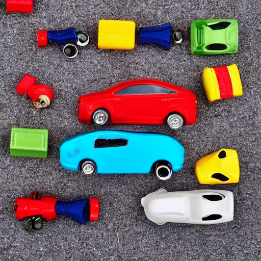
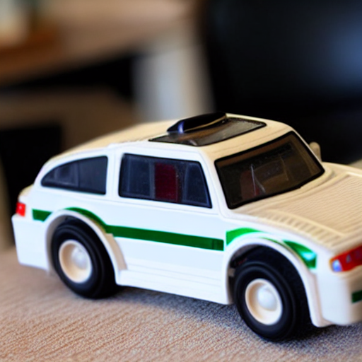
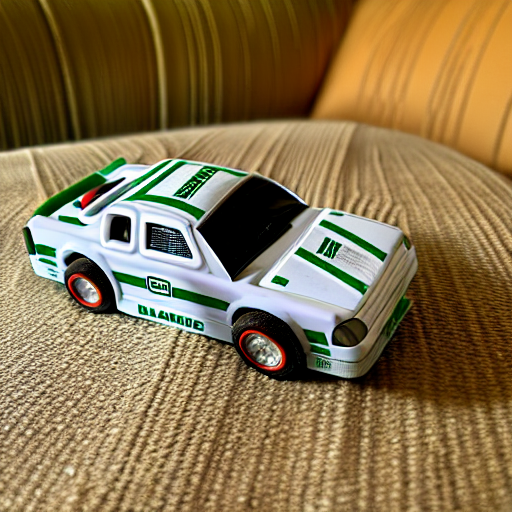

# Personalizing Stable Diffusion: Textual Inversion vs DreamBooth (LoRA)

Teaching **Stable Diffusion v1.5** a new visual concept (a specific toy car) from only **10 photos**,
and comparing two personalization methods: **Textual Inversion**, which learns a single new word
embedding, and **DreamBooth with LoRA**, which fine-tunes low-rank adapters of the UNet.

Team project (ENSIAS):
[@mtaarik](https://github.com/mtaarik) (project setup, image preprocessing, baseline),
[@SafaeBenabbou](https://github.com/SafaeBenabbou) (Textual Inversion),
[@nadasomate](https://github.com/nadasomate) (DreamBooth LoRA).

## Results

| | Baseline (no training) | Textual Inversion | DreamBooth (LoRA) |
|---|---|---|---|
| Example |  |  |  |
| What is learned | nothing | one token embedding `<toycar>` | LoRA weights of the UNet |
| Trained file size | n/a | **4 KB** | 3.1 MB |
| Training steps | n/a | 1,000 (lr 5e-4) | 800 (lr 1e-4) |
| Training time (Colab GPU) | n/a | 73.9 min | **24.1 min** |
| Fidelity to the real object | generic toy car | general concept | **closest to the real object, more details kept** |

**Takeaway:** DreamBooth LoRA gives the best visual fidelity and trains three times faster, while
Textual Inversion produces an extremely light artifact (4 KB) that plugs into any prompt.

More generated images: [`results/`](results/).

## Pipeline

1. **Dataset:** 10 photos of the toy car from different viewpoints (`dataset/raw/`).
2. **Preprocessing** (`src/preprocess_dataset.py`): center crop and resize to 512×512
   (`dataset/processed/`).
3. **Baseline** (`notebooks/01_baseline.ipynb`): what Stable Diffusion v1.5 generates for a toy car
   prompt without any training.
4. **Textual Inversion** (`notebooks/02_textual_inversion.ipynb`): learns the placeholder token
   `<toycar>`, prompt example: `a photo of <toycar> on a table`.
5. **DreamBooth LoRA** (`notebooks/03_dreambooth.ipynb`): fine-tunes LoRA adapters with the instance
   prompt `a photo of sks toycar`.

## Repository structure

```text
dataset/
  raw/                         10 original photos
  processed/                   512x512 images used for training
src/preprocess_dataset.py      crop and resize
notebooks/                     baseline, Textual Inversion, DreamBooth (run on Google Colab)
models/
  textual_inversion_output/    learned_embeds.safetensors (4 KB)
  dreambooth_lora_output/      pytorch_lora_weights.safetensors (3.1 MB)
results/                       generated images for each method
```

## Run it

The notebooks were run on Google Colab with a GPU, using Hugging Face `diffusers` training scripts
and the `runwayml/stable-diffusion-v1-5` checkpoint.

```bash
pip install -r requirements.txt
python src/preprocess_dataset.py
```

Then open the notebooks in order (`01` → `03`).
